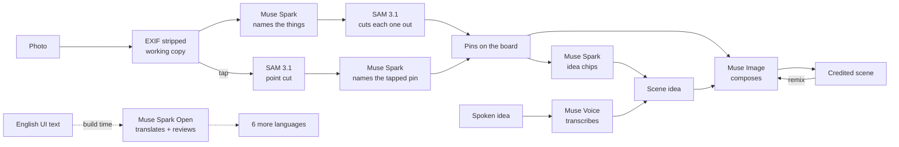

# Pinneds — your stuff, pinned together

Friends drop photos onto one shared board. Meta's models cut out the things in them, and
anyone can mix everyone's pins into new scenes that credit whose things are in them.

- **Live app:** https://pinneds.com (live from Nov 1)
- **Dev, live models:** https://dev.pinneds.com
- **Video:** 3-minute video: link added at submission <!-- VIDEO_URL -->
- **Hackathon:** [Meta Global AI Developer Hackathon](https://cerebralvalley.ai/e/meta-ai-developer-hackathon/details),
  Indie track, theme *Build for Your World*. Solo developer, Oct 26 – Nov 4, 2026.

<p align="center">
  
</p>
<p align="center"><sub>A scene from the landing page, made from three made-up friends' pins: a cat, a
beanie with heart sunglasses, a skateboard. Muse Image made their photos, Muse Spark named
the things, SAM 3.1 cut them out and Muse Image composed the scene
(<a href="docs/17-showcase-sets.md">docs/17</a>).</sub></p>

## What it does in 30 seconds

1. **Share.** Start a board and send its link to the group chat. No app, no sign-up: the
   link is the invitation.
2. **Pin.** Anyone adds a photo. Muse Spark names the things in it, SAM 3.1 cuts each one
   out, and they land on the board as stickers with the owner's name. Missed something?
   Tap it in the photo.
3. **Make a scene.** Pick 1–4 pins from anyone, then type an idea, tap a suggested one or
   say it out loud. Muse Image composes a new picture, "Made from" the people whose things
   are in it.
4. **Remix.** Any scene can be remixed with new pins and a new idea; the credits carry
   everyone who contributed.

Also: owners can rename or delete their pins (deleting one hides the scenes that used
it); people are allowed in photos, and a face gets a one-line consent note, never a
block; optional Google sign-in adds *My boards* and *My pins* on every device but never
gates a board; the UI speaks 7 languages (English, French, Spanish, Portuguese (Brazil),
German, Italian, Indonesian), chosen per visitor from one shared link.

## How Meta's models power it

Five Meta models. Four run inside the app behind six capability ports in `src/gateway/`;
the fifth ran at build time. Prompts, Policy keys, fallbacks, costs and evidence for each:
[`docs/19-meta-models.md`](docs/19-meta-models.md).

| Model (ID) | What it does in Pinneds | Port |
| --- | --- | --- |
| **Muse Spark** (`muse-spark-1.3`) | Names 1–6 things per photo as short noun phrases SAM can cut, and flags faces (`elements.v1`). Names a cut-out you tapped, from its crop (`tap-name.v1`). Suggests scene ideas for the picked pins in the viewer's UI language, cached 24 h per language (`chips.v2`). | `ElementNamer`, `TapNamer`, `ChipSuggester` |
| **SAM 3.1** (`sam-3.1`) | Cuts out each named thing (one concept per call, four calls at a time) and whatever you tap (point prompt), keeping the most confident usable mask. | `Segmenter` |
| **Muse Image** (`muse-image-1.0`) | Composes 1–4 pins into one new scene through `/v1/responses` (`scene.v1`, `store: false`); a remix sends the parent scene first. It also made the source photos of the Meta-made landing sets. | `SceneComposer` |
| **Muse Voice Transcribe** (`muse-voice-transcribe-1.0`) | Turns a spoken scene idea (up to 30 s) into text. The audio is never stored. | `SpeechTranscriber` |
| **Muse Spark Open** (`meta-models/muse-spark-open-1026`, on Baseten) | Build time only: translated the UI into six languages, with a second reviewer pass (`translate-ui.v1`, `review-ui.v1`). Never called by the running app. | `scripts/i18n-translate.mjs` |

Every runtime call goes through one decorator chain (`src/gateway/decorators.ts`):
timeout → retry once on 429/5xx → reserve budget, fail closed → call → log the estimated
cost → a typed `ready / failed / refused` outcome. A refusal is a friendly line, never a
500, and a scene that runs out of AI budget becomes a free collage of the cut-outs.



## Architecture

Spec: [`docs/11-studio.md`](docs/11-studio.md) §5. Decisions:
[ADR-003](docs/adr/003-studio-architecture.md).

- **Policy as data.** One typed Zod `Policy` (`src/policy/policy.ts`) holds every count,
  size, cap, timeout and TTL: defaults in code, then env `POLICY_OVERRIDES_JSON`, then
  per-board overrides. Prompts, validators and the UI read the same object.
  `src/config.ts` is the only file that reads `process.env`.
- **Six ports and decorators.** `ElementNamer`, `TapNamer`, `ChipSuggester`, `Segmenter`,
  `SceneComposer` and `SpeechTranscriber` each have a Meta adapter (plain `fetch`, no
  provider SDK), a mock adapter (the default, `AI_MOCK=1`) and a recorded-fixture
  adapter. Product code only gets the decorated ports (`src/server/ai-ports.ts`). Spend
  is reserved before a call on a per-day counter, with per-person and per-board caps.
- **Jobs, request and poll.** A `DecomposeJob` (photo → pins) and a `SceneJob` (pins →
  scene) move `pending → running → ready / failed / refused`, idempotent by id with
  claim-before-call, so a repeated request never pays twice. The request does the work;
  the board page polls (TanStack Query). No queue.
- **Data model** (`src/domain/board.ts`). An `Element` is an owned cut-out, a `Pin` puts
  it on a `Board`, and a `Scene` credits its `elementIds` and records its `promptVersion`
  and `costUsd`. Firestore when hosted, in memory locally. Board links are 128-bit
  capability slugs, validated before any data path is built.
- **Privacy.**
  - Original photos are never stored. An upload is checked, stripped of EXIF and
    re-encoded into a working copy under `tmp/`. Only cut-outs (`elements/`) and scenes
    (`scenes/`) persist, served through routes that check the board link; client
    Firestore and Storage rules deny everything.
  - The working copy is deleted when the uploader confirms their pins ("Pin N"). Any copy
    older than Policy `workingCopyTtlHours` (24 h) is swept the next time someone adds a
    photo to that board, and a bucket lifecycle rule in `storage.lifecycle.json` deletes
    leftover working copies as the backstop.
  - Calls to Meta run in Standard mode: not used for training, which is not the same as
    not stored. The Muse Image compose call sends `store: false`. We make no "zero data
    retention" claim.

## Run it locally

### Offline, with mock models (no key)

Needs Node 20.9+ and npm. The defaults in `.env.example` (`AI_MOCK=1`,
`DATA_BACKEND=memory`) run the whole loop with no key and no paid calls. Mock pins are
always the same few things, and a mock scene is a collage of the cut-outs.

```bash
git clone https://github.com/MoriaCrew/Pinned.git
cd Pinned
npm install
cp .env.example .env.local   # PowerShell: Copy-Item .env.example .env.local
node -e "console.log(require('crypto').randomBytes(32).toString('hex'))"
# paste that value after SESSION_SECRET= in .env.local (joining a board needs it)
npm run dev
```

Open http://localhost:3000 and start a board. Health check:
http://localhost:3000/api/health.

### With live models

Set `AI_MOCK=0` and your own `META_API_KEY` in `.env.local` (never commit it; see
`SECURITY.md`). `META_MODEL_SPARK`, `META_MODEL_SAM`, `META_MODEL_IMAGE` and
`META_MODEL_VOICE` override the model IDs. `AI_DAILY_BUDGET_USD` (default 5; `0` turns AI
off) and `AI_DAILY_CALL_LIMIT` (default 500) cap the day's spend. Every call logs an
estimated cost (`docs/16-ai-usage.md`). Hosting is Firebase App Hosting: the `dev` branch
builds the dev backend and `main` builds prod (`apphosting*.yaml`,
[`docs/DEPLOY.md`](docs/DEPLOY.md)).

## Tests and CI

```bash
npm run typecheck
npm test
npm run build
```

On `dev` at `f010eb7` (Oct 31, 2026), `npm test` reports **1,507 tests passed, 2
skipped**, in 133 test files. CI (`.github/workflows/ci.yml`) runs all three with
`AI_MOCK=1`, so it never makes a paid model call. Gitleaks scans the full history on every
PR (`.github/workflows/secret-scan.yml`) and runs as a pre-commit hook, and Cursor Bugbot
reviews every PR. Domain and Policy logic have unit tests; the gateway has contract tests
that replay recorded spike fixtures (`eval/fixtures/studio/`). Live-model runs happen by
hand, with cost logged; results are in [`eval/studio-findings.md`](eval/studio-findings.md).

## Billing: Board Plus

`PLUS_MODE` is `off` (the default: nothing is sold), `mock` (a no-money demo) or `stripe`.
With `stripe` the app sells one pack, **Board Plus (€2.99, Stripe)**: once per board, it
unlocks every board look and foil stickers and adds 20 creations (AI makes). Any member
can buy it for the board; guests never have to pay. Creations are a Policy switch
(`credits.enabled`, off in code): when on, a maker's first 3 boards a week start with 5
free (later ones start at 0), each AI scene uses one (photos and cut-outs never do), and a
collage is free. A board without Plus cuts up to 15 free photos; Plus removes that limit. Purchases are granted by Stripe webhook only, and
keys come from Secret Manager, never git. Design and runbook:
[`docs/15-board-plus.md`](docs/15-board-plus.md).

## Docs

- [`docs/README.md`](docs/README.md): index of every doc
- [`docs/19-meta-models.md`](docs/19-meta-models.md): each Meta model, prompt, cost and fallback
- [`docs/11-studio.md`](docs/11-studio.md): product and architecture spec
- [`docs/adr/003-studio-architecture.md`](docs/adr/003-studio-architecture.md): Policy, ports, jobs, remix
- [`docs/DEPLOY.md`](docs/DEPLOY.md): deploy runbook and env matrix
- [`docs/13-auth.md`](docs/13-auth.md): optional Google sign-in
- [`docs/15-board-plus.md`](docs/15-board-plus.md): Board Plus and creations
- [`docs/16-ai-usage.md`](docs/16-ai-usage.md): AI call log and cost estimates
- [`docs/17-showcase-sets.md`](docs/17-showcase-sets.md): how the landing sets are made
- [`docs/18-i18n.md`](docs/18-i18n.md): languages and translation
- [`SECURITY.md`](SECURITY.md) and [`AGENTS.md`](AGENTS.md): public-repo guardrails and agent rules

## Known limits

- **Cuts can miss.** Sometimes SAM finds no usable mask for a named thing, and it doesn't
  become a pin; tapping it in the photo is the workaround. Spark names the same photo a
  little differently from run to run.
- **Costs are estimates** from Meta list prices (`src/gateway/costs.ts`). The provider
  dashboard is authoritative.
- **Not every picture is from Meta.** The classic landing set, the `/new` look-picker
  samples (`public/start/`), the board theme art (`public/themes/`) and the eval fixture
  photos are Higgsfield images (SAM 3.1 cut out the stickers). The try-on and cat landing
  sets are Meta end to end.
- **AI-written text is English in places.** Pin names and some scene text stay English
  whatever the UI language (PIN-200). Generated idea chips follow the UI language
  (PIN-214); the fixed starter chips stay English until their translations land.
- **Machine translations.** Muse Spark Open wrote and reviewed them; no native speaker has
  checked them yet. Latin-script languages only.

## Built with

Next.js 15 (App Router) and TypeScript, Firebase App Hosting, Firestore and Cloud Storage,
the Meta Model API, Stripe Checkout, sharp, Zod, TanStack Query and Vitest; built by one
developer with AI coding agents, one issue per PR ([`docs/03-ai-sdlc.md`](docs/03-ai-sdlc.md)).
`PIN-n` in code and commits is the Linear issue ID; history is in `git log`.

## License

Copyright (C) 2026 Moria Crew. AGPL-3.0 — see `LICENSE`. In short: you may use, study and modify this
code, but if you offer a modified version to others over a network you
must release your source under the same licence. Hackathon note: the
organisers separately receive a broad licence to submitted materials
under the event rules; the AGPL governs reuse by everyone else.
